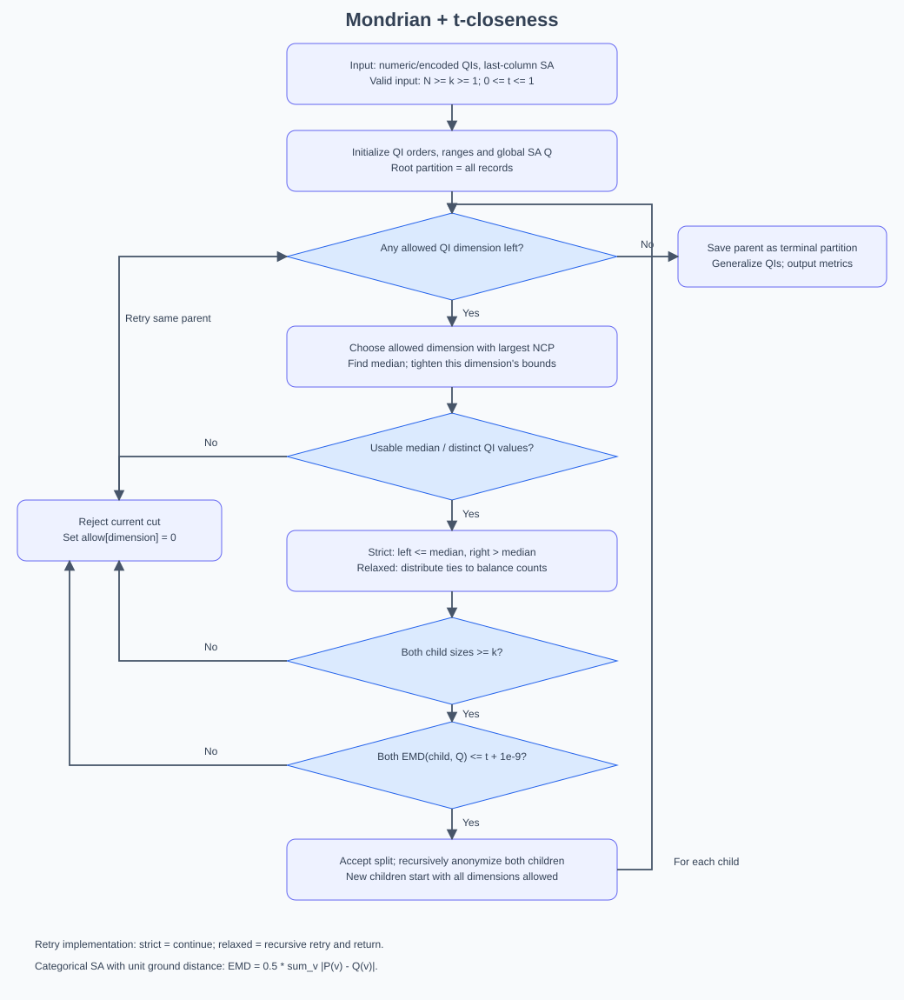
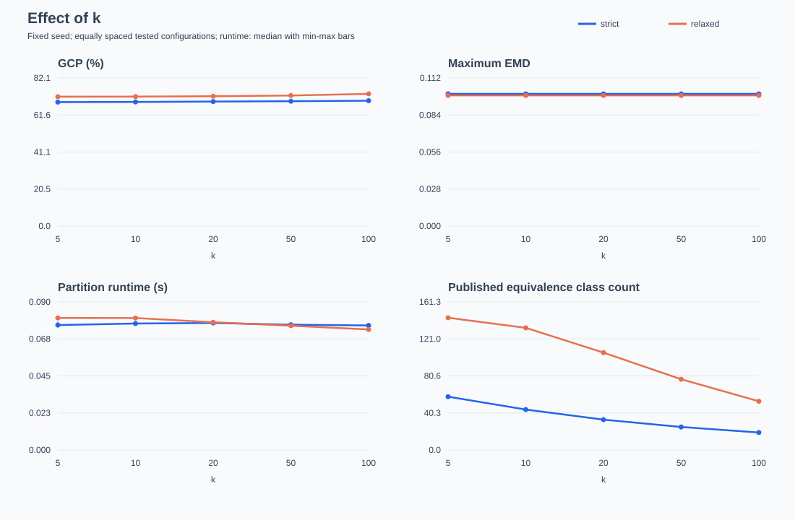
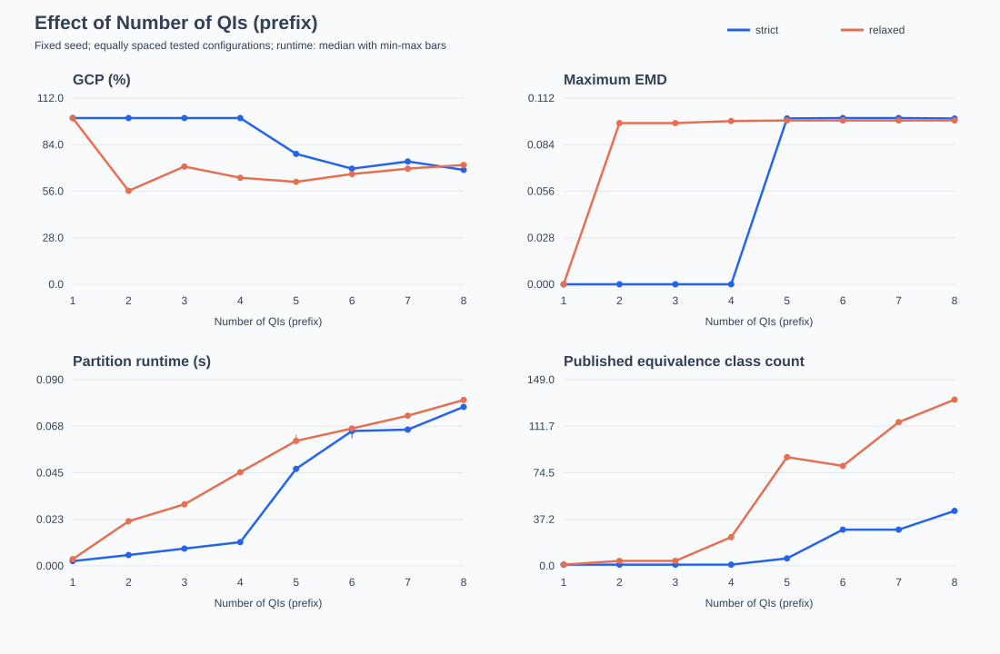
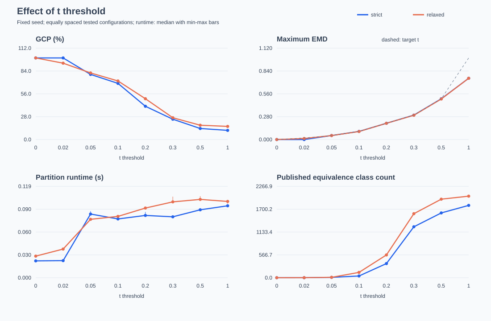
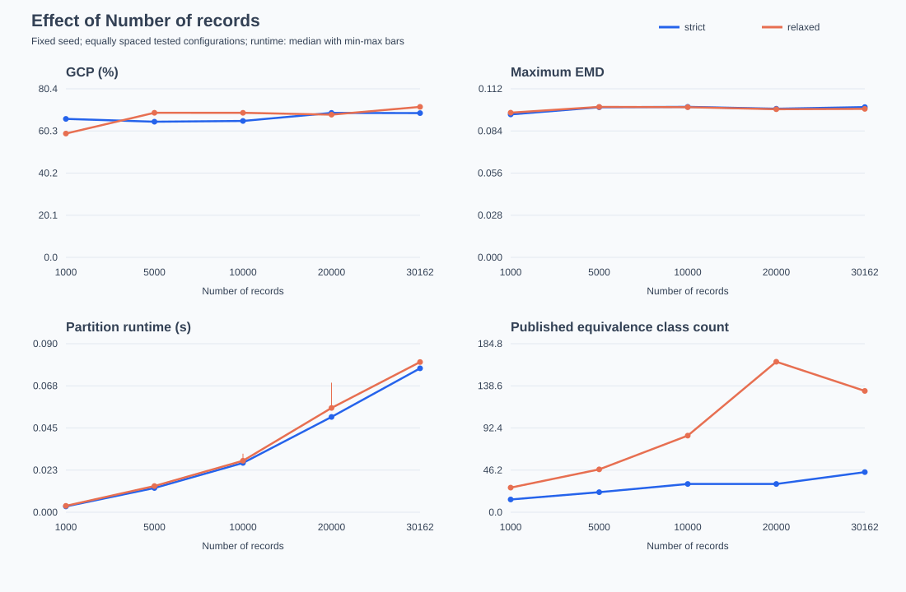

# 满足 T-Closeness 的 Mondrian 算法实验报告

## 一、问题描述

在发布包含个人信息的数据时，如果直接保留年龄、职业等属性，攻击者可能将这些属性与其他数据结合，从而识别出某个人。因此，需要在发布前对数据进行匿名化处理，在保护隐私的同时尽量保留数据的分析价值。

本实验使用 Adult 数据集，将年龄等属性作为准标识符（QI），将收入标签 `income` 作为敏感属性（SA）。准标识符本身不一定能唯一识别一个人，但多个准标识符组合起来可能具有识别能力；敏感属性则是希望避免被直接推断的信息。

基础 Mondrian 算法通过不断划分数据，并将同一组记录的准标识符泛化成相同的区间，实现 k-anonymity。其要求每个等价类至少包含 \(k\) 条记录。但是，记录数量足够并不代表敏感信息安全。例如，一个等价类有 10 条记录，且所有人的收入都大于 50K，那么即使攻击者无法区分这 10 个人，也能推断出其中某人的收入类别。

为解决这一问题，本实验在 Mondrian 算法中加入 t-closeness 条件，要求每个等价类的敏感属性分布与全局分布之间的距离不超过 \(t\)。实验需要完成以下任务：

1. 统计敏感属性的全局分布，并计算等价类与全局分布之间的 EMD 距离。
2. 在严格划分和松弛划分两种模式中，同时检查 k-anonymity 与 t-closeness。
3. 分析 \(k\)、`qi`、\(t\)、`datasize` 对信息损失 GCP、最大 EMD、运行时间和等价类数量的影响。
4. 比较两种隐私规则的作用，理解隐私保护与数据可用性之间的取舍。

## 二、解决思路

### 2.1 在划分过程中同时检查两种约束

Mondrian 是一种自顶向下的多维划分算法。最开始将所有记录放在一个分区中，然后选择准标识符维度，按照中位数将当前分区分成左右两个子分区。如果子分区满足隐私要求，就继续递归划分；如果所有可尝试的维度都不能产生合法划分，则保留当前分区。

本实验的关键修改是：**在检查左右子分区的记录数均不少于 \(k\) 之后，再检查两者是否分别满足 t-closeness。** 两个子分区都满足要求，才接受这次切分。

设当前分区为 \(C\)，左右子分区为 \(L\)、\(R\)，敏感属性全局分布为 \(Q\)，合法切分需要同时满足：

\[
|L|\ge k,\qquad |R|\ge k,
\]

\[
EMD(P_L,Q)\le t,\qquad EMD(P_R,Q)\le t.
\]

其中 \(P_L\)、\(P_R\) 分别表示左右子分区的敏感属性分布。这里始终与本次输入数据的全局分布比较，而不是与父分区的分布比较。

如果某次候选切分不合法，就把当前维度标记为不可用，继续尝试当前分区的其他维度，而不是直接结束整个分区的处理。全部维度均不可用时，才将该分区保存为最终结果。

整个输入数据与自身分布之间的 EMD 为 0，因此根分区满足 t-closeness。在输入记录数不少于 \(k\) 的前提下，每次只接受满足两种规则的子分区，就能使最终保留的分区也满足这两种规则。本实验不删除记录，而是通过扩大泛化范围来满足约束。

### 2.2 全局分布与 EMD 的计算

对于敏感属性取值 \(v\)，先统计其在输入数据中的出现次数，再除以总记录数 \(N\)，得到全局概率：

\[
Q(v)=\frac{\text{输入数据中敏感值为 }v\text{ 的记录数}}{N}.
\]

对某个等价类 \(C\)，同样计算类内概率：

\[
P_C(v)=\frac{\text{等价类 }C\text{ 中敏感值为 }v\text{ 的记录数}}{|C|}.
\]

本实验的收入标签是类别型属性，不同类别之间的 ground distance 取 1。因此，按照 `README.md` 的说明，EMD 可以简化为：

\[
EMD(P_C,Q)=\frac{1}{2}\sum_v|P_C(v)-Q(v)|.
\]

计算时需要考虑全部敏感属性取值；某个取值没有出现在等价类中时，其类内概率为 0，不能直接忽略。

Adult 数据中的收入只有 `<=50K` 和 `>50K` 两类。设全局高收入比例为 \(q\)，等价类内高收入比例为 \(p\)，则上式进一步简化为：

\[
EMD(P_C,Q)=|p-q|.
\]

所以在本实验中，\(t\) 可以直观地理解为：允许等价类内高收入比例相对于全局比例偏离的最大幅度。实现中使用 \(10^{-9}\) 的容差，避免浮点误差导致边界值被误判。

### 2.3 严格划分与松弛划分

- **严格划分（strict）**：将准标识符值小于或等于中位数的记录放到左侧，大于中位数的记录放到右侧。相同取值不会在当前切分维度上被分到两侧，但重复值较多时，左右记录数可能不平衡。
- **松弛划分（relaxed）**：先分别放置小于和大于中位数的记录，再将等于中位数的记录按数量分配到左右两侧，使两侧大小尽量接近。当前实现按输入顺序分配这些并列记录，没有专门按照敏感属性优化分配。

松弛划分允许左右泛化区间在中位数处重叠，但每条记录仍然只属于一个内部分区，不会被重复发布。它增加了切分的灵活性，不过不保证最终 GCP 一定低于严格划分。

## 三、算法具体流程图

*图 1：满足 T-Closeness 的 Mondrian 算法流程。图中的 QI 表示准标识符，SA 表示敏感属性，Q 表示全局敏感属性分布，NCP 表示当前维度的归一化区间宽度。*

算法的具体步骤如下：

1. **输入与初始化**：读入数据，设置 \(k\)、`qi`、\(t\) 和划分模式；初始化准标识符的排序取值、全局跨度及取值索引，统计敏感属性的全局分布。
2. **建立根分区**：将全部输入记录作为初始分区，各准标识符维度初始均允许尝试切分。
3. **选择维度**：从当前允许的维度中，选择归一化跨度最大的维度。使用归一化跨度可以减少不同属性量纲对选择结果的影响。
4. **寻找中位数**：统计该维度的取值频率，找到中位数，并将当前维度的分区边界收紧到实际取值范围。如果记录数不足以分成两个至少含 \(k\) 条记录的子集，或没有可用的不同取值，则放弃当前维度。
5. **形成候选子分区**：根据严格或松弛规则分配记录，并设置左右子分区的泛化边界。
6. **检查 k-anonymity**：如果任一子分区小于 \(k\)，拒绝本次切分，禁用当前维度，返回步骤 3。
7. **检查 t-closeness**：分别计算左右子分区与全局分布的 EMD。如果任一结果超过 \(t\)（考虑浮点容差），同样拒绝切分并尝试其他维度。
8. **递归处理**：两种检查均通过时，接受切分，对两个子分区重复步骤 3—7。新子分区重新允许尝试全部维度。
9. **保存与输出**：若当前分区所有维度都已不可用，保存该分区；全部递归完成后，将各分区内的准标识符替换为对应区间，输出匿名结果并计算评价指标。

严格模式通过循环继续尝试其他维度；松弛模式通过对同一分区再次递归调用实现重试。两者的隐私检查原则相同。

需要注意，本实现每个维度只尝试中位数候选切分。中位数切分失败后，不再搜索该维度的所有其他切分点。因此，“无法继续划分”表示当前算法没有找到可接受的候选切分，不代表不存在任何其他合法划分。这也是其不保证信息损失全局最小的原因之一。

## 四、参数实验与结果分析

### 4.1 数据、设置及指标说明

本报告直接使用已有的 `run_experiments.py` 和 `experiment_results/` 中的实验结果。原始测量保存在 `measurements.csv`，汇总结果及实验设置保存在 `summary.json`，四组参数变化图也由该脚本生成。

**数据处理与环境：**

- 使用项目中的 `data/adult.data`，删除空行和包含 `?` 的缺失记录后，保留 **30162 条记录**。
- 敏感属性为 `income`。全量有效数据中，`<=50K` 有 22654 条，占约 75.11%；`>50K` 有 7508 条，占约 24.89%。
- 按顺序使用 8 个准标识符：`age`、`work_class`、`education_num`、`marital_status`、`occupation`、`race`、`sex`、`native_country`。
- 其中 `age` 和 `education_num` 为数值属性，其余类别型准标识符按首次出现顺序编码为整数，再用数值型 Mondrian 处理。编码距离不代表类别之间真实的语义距离，因此涉及这些属性的 GCP 是当前编码方式下的区间损失。
- 结果文件记录的实验环境为 macOS 26.6、ARM64，Python 3.15.1。

**控制变量设置：**

| 改变的参数 | 取值 | 保持不变的参数 |
| --- | --- | --- |
| \(k\) | 5、10、20、50、100 | `qi=8`，\(t=0.1\)，`datasize=30162` |
| `qi` | 1、2、3、4、5、6、7、8 | \(k=10\)，\(t=0.1\)，`datasize=30162` |
| \(t\) | 0、0.02、0.05、0.1、0.2、0.3、0.5、1.0 | \(k=10\)，`qi=8`，`datasize=30162` |
| `datasize` | 1000、5000、10000、20000、30162 | \(k=10\)，`qi=8`，\(t=0.1\) |

每组实验分别使用严格和松弛两种模式。先用随机种子 `20261102` 打乱全量数据，再取不同长度的前缀作为数据规模实验的输入。因此，不同规模的样本是嵌套的，而不是分别重新抽样。每种独立配置先预热 1 次，再正式运行 3 次，运行时间取中位数；其他指标在这 3 次中一致。各组共用的基准配置复用测量结果，共有 46 种独立配置、138 次正式运行。

**评价指标：**

1. **GCP：衡量准标识符泛化带来的信息损失。** 对等价类 \(C\) 的第 \(i\) 个准标识符，设泛化区间为 \([a_{C,i},b_{C,i}]\)，输入数据中该属性的全局跨度为 \(R_i\)，准标识符数量为 \(d\)，则：

\[
GCP=\frac{\sum_C|C|\sum_{i=1}^{d}\frac{b_{C,i}-a_{C,i}}{R_i}}{N\cdot d}.
\]

理论上 GCP 在 0 到 1 之间，越小表示信息损失越少。代码将其乘以 100，因此下表使用 **GCP（%）**，100% 表示所选准标识符均泛化到全局范围。GCP 不是攻击成功率，也不是分类准确率。

2. **max EMD：衡量偏离全局敏感分布最严重的等价类。** 本报告使用内部最终分区 EMD 的最大值，越小表示各分区的收入分布越接近全局分布。实验还检查了发布后的等价类，本次全部配置的发布后最大 EMD 与内部最大 EMD 相同。
3. **RunTime：递归划分阶段的运行时间，单位为秒。** 它包含划分与划分过程中的隐私检查，但不包含数据读取、初始化、最终泛化及结果指标统计。因此，不能把它当作完整的数据处理耗时。图中的时间误差线表示 3 次测量的最小值到最大值，不是置信区间。
4. **等价类数量：发布数据中所选准标识符泛化结果相同的记录组数。** 表格与曲线使用 `released_ec_count`。松弛模式可能产生相同泛化区间的多个内部分区，发布后应将它们视为同一个等价类。例如 `qi=2` 时，松弛模式有 5 个内部分区，但只有 4 个发布等价类。

已有结果中，各配置的内部最小分区大小均不小于 \(k\)，t-closeness 违反数均为 0；实验脚本也检查了发布后的等价类均满足两种约束。表中 GCP 保留两位小数，max EMD 保留五位小数，RunTime 保留四位小数，约束核验使用未四舍五入的原始值。

另需说明，`qi` 表示使用上述列表的前多少个属性参与划分、泛化与等价类判定。未选中的属性在当前输出中保持原值，因此 `qi` 较小的实验只验证所选准标识符上的匿名约束，不能据此认为整张输出表已对所有潜在准标识符实现 k-anonymity。

### 4.2 参数 k 的影响

*图 2：改变 k 的实验结果。蓝线为严格模式，橙线为松弛模式。各图横轴按测试配置等距排列，连线用于展示变化趋势。*

| k | 模式 | GCP（%） | max EMD | RunTime（s） | 等价类数量 |
| --- | --- | ---: | ---: | ---: | ---: |
| 5 | strict | 68.74 | 0.09971 | 0.0760 | 58 |
| 5 | relaxed | 71.74 | 0.09854 | 0.0803 | 144 |
| 10 | strict | 68.82 | 0.09971 | 0.0769 | 44 |
| 10 | relaxed | 71.79 | 0.09854 | 0.0802 | 133 |
| 20 | strict | 69.04 | 0.09971 | 0.0772 | 33 |
| 20 | relaxed | 71.99 | 0.09854 | 0.0776 | 106 |
| 50 | strict | 69.23 | 0.09971 | 0.0762 | 25 |
| 50 | relaxed | 72.40 | 0.09854 | 0.0755 | 77 |
| 100 | strict | 69.50 | 0.09971 | 0.0757 | 19 |
| 100 | relaxed | 73.30 | 0.09854 | 0.0732 | 53 |

**（1）对 GCP 的影响。** k 越大，每个子分区需要保留的记录越多，一些原本可行的小分区不能继续被切分，因此通常需要更大的泛化区间。本组实验中，严格模式 GCP 从 68.74% 增加到 69.50%，松弛模式从 71.74% 增加到 73.30%，均表现为上升，但上升幅度不大。这说明在 \(t=0.1\) 时，敏感分布约束已经限制了较多切分，继续提高 k 的影响相对有限。

**（2）对 max EMD 的影响。** 严格模式的 max EMD 始终约为 0.09971，松弛模式始终约为 0.09854。k 限制的是等价类大小，并不直接限制敏感属性分布。虽然类数量减少了，但最大距离没有随之降低，所以不能认为增大 k 就一定能改善 t-closeness 指标。

**（3）对 RunTime 的影响。** 严格模式的时间在约 0.076 秒附近小幅波动，没有明显的单调趋势；松弛模式从约 0.0803 秒减少到 0.0732 秒。较大的 k 会减少后续递归，但算法仍需扫描较大的分区并尝试候选维度，因此类数量明显下降并不意味着时间会按相同比例下降。

**（4）对等价类数量的影响。** 严格模式从 58 个减少到 19 个，松弛模式从 144 个减少到 53 个。较大的 k 使合法切分更少，最终形成更大的类，这与 k-anonymity 的要求一致。不过，实际类数量远少于 \(N/k\)，说明分区停止的原因不只是记录数，还包括 t-closeness 与重复取值等限制。

### 4.3 参数 qi 的影响

*图 3：改变准标识符数量 qi 的实验结果。qi 每增加 1，就按既定顺序加入一个属性，而不是随机选取属性组合。*

| qi | 模式 | GCP（%） | max EMD | RunTime（s） | 等价类数量 |
| --- | --- | ---: | ---: | ---: | ---: |
| 1 | strict | 100.00 | 0.00000 | 0.0023 | 1 |
| 1 | relaxed | 100.00 | 0.00000 | 0.0033 | 1 |
| 2 | strict | 100.00 | 0.00000 | 0.0053 | 1 |
| 2 | relaxed | 56.25 | 0.09697 | 0.0216 | 4 |
| 3 | strict | 100.00 | 0.00000 | 0.0084 | 1 |
| 3 | relaxed | 70.83 | 0.09697 | 0.0298 | 4 |
| 4 | strict | 100.00 | 0.00000 | 0.0115 | 1 |
| 4 | relaxed | 64.09 | 0.09818 | 0.0453 | 23 |
| 5 | strict | 78.46 | 0.09975 | 0.0469 | 6 |
| 5 | relaxed | 61.63 | 0.09854 | 0.0605 | 87 |
| 6 | strict | 69.54 | 0.09999 | 0.0652 | 29 |
| 6 | relaxed | 66.31 | 0.09854 | 0.0664 | 80 |
| 7 | strict | 73.88 | 0.09999 | 0.0659 | 29 |
| 7 | relaxed | 69.57 | 0.09854 | 0.0726 | 115 |
| 8 | strict | 68.82 | 0.09971 | 0.0769 | 44 |
| 8 | relaxed | 71.79 | 0.09854 | 0.0802 | 133 |

**（1）对 GCP 的影响。** 本次结果并不支持“qi 越多，GCP 一定越大”。严格模式在 `qi=1` 到 `qi=4` 时均为 100%，只保留了根分区，说明已有维度的候选切分均被拒绝。加入第 5 个属性后，算法有了新的可尝试方向，GCP 降至 78.46%；增加到 8 个属性时，GCP 为 68.82%。

但增加属性也不一定降低 GCP。严格模式从 `qi=6` 到 `qi=7` 时，等价类数量仍为 29，GCP 却从 69.54% 上升到 73.88%。松弛模式从 `qi=2` 到 `qi=3` 时，类数量仍为 4，GCP 从 56.25% 上升到 70.83%。这是因为 GCP 是对所选属性损失的平均值，增加一个泛化较多的属性，即使类数量不变，也会抬高平均损失。

因此，改变 qi 同时改变了候选切分维度、具体属性组合和 GCP 的计算范围。不能只用 qi 的数量解释全部变化，也不能简单认为 `qi=2` 的结果比 `qi=8` 更适合实际发布。

**（2）对 max EMD 的影响。** 只有一个类时，它就是整个输入数据，因此 max EMD 为 0。产生更多类后，max EMD 上升到接近 0.1，并始终满足阈值。严格模式从 `qi=6` 到 `qi=8`，最大值还略有下降，说明 max EMD 不随维度数量严格单调变化。

**（3）对 RunTime 的影响。** 两种模式的时间总体随 qi 增加而增长。严格模式从约 0.0023 秒增加到 0.0769 秒，松弛模式从约 0.0033 秒增加到 0.0802 秒。更多维度意味着更多宽度比较、频率统计与失败切分尝试，同时也可能产生更多后续递归。即使严格模式前四种配置都只有一个类，时间也在增长，说明尝试并拒绝切分本身也有成本。

**（4）对等价类数量的影响。** 严格模式从 1 个增加到 44 个，松弛模式从 1 个增加到 133 个，总体增加，但不严格单调。例如松弛模式从 `qi=5` 到 `qi=6` 时，类数量从 87 个减少到 80 个。新增维度可能改变后续的贪心切分路径，因而不一定只是对原有结果继续细分。

### 4.4 参数 t 的影响

*图 4：改变 t 的实验结果。max EMD 子图中的虚线表示目标阈值 t；横轴为等距排列的测试配置，并非按 t 的数值间隔绘制。*

| t | 模式 | GCP（%） | max EMD | RunTime（s） | 等价类数量 |
| --- | --- | ---: | ---: | ---: | ---: |
| 0 | strict | 100.00 | 0.00000 | 0.0221 | 1 |
| 0 | relaxed | 100.00 | 0.00000 | 0.0283 | 1 |
| 0.02 | strict | 100.00 | 0.00000 | 0.0224 | 1 |
| 0.02 | relaxed | 93.59 | 0.01293 | 0.0375 | 2 |
| 0.05 | strict | 79.81 | 0.04945 | 0.0833 | 10 |
| 0.05 | relaxed | 81.62 | 0.04898 | 0.0764 | 11 |
| 0.1 | strict | 68.82 | 0.09971 | 0.0769 | 44 |
| 0.1 | relaxed | 71.79 | 0.09854 | 0.0802 | 133 |
| 0.2 | strict | 40.77 | 0.19943 | 0.0815 | 352 |
| 0.2 | relaxed | 50.03 | 0.19935 | 0.0911 | 566 |
| 0.3 | strict | 24.91 | 0.29946 | 0.0797 | 1264 |
| 0.3 | relaxed | 26.73 | 0.29769 | 0.0992 | 1589 |
| 0.5 | strict | 13.53 | 0.49967 | 0.0888 | 1608 |
| 0.5 | relaxed | 17.54 | 0.49684 | 0.1024 | 1949 |
| 1.0 | strict | 11.24 | 0.75108 | 0.0941 | 1795 |
| 1.0 | relaxed | 16.12 | 0.75108 | 0.0998 | 2024 |

**（1）对 GCP 的影响。** t 越小，要求类内收入分布越接近全局分布，切分越容易被拒绝，信息损失通常越高。本组测试点中，随着 t 增大，两种模式的 GCP 均下降。严格模式从 100% 降到 11.24%，松弛模式从 100% 降到 16.12%，变化远大于本报告中 k 实验的变化幅度。

在 \(t=0\) 时，本次两种模式都只保留了整个输入数据。这说明当前候选切分没有找到分布完全一致的子分区，并不表示所有数据集在 \(t=0\) 时都只能产生一个类。

**（2）对 max EMD 的影响。** 随着 t 放宽，实际最大 EMD 从 0 增加到约 0.75108。在 \(t=0.05\) 到 \(t=0.5\) 的多个配置中，最大值接近对应阈值，说明该条件确实限制了继续细分。实际值不需要等于阈值，只要不超过阈值即可；例如 \(t=0.02\) 的松弛模式只有约 0.01293。

当 \(t=1\) 时，类别型 EMD 本身不超过 1，因此 t-closeness 检查不会拒绝任何切分。在当前实现下，可以将这一配置作为只受 k-anonymity 等基础切分条件约束的对照。它并不表示实际最大 EMD 必须达到 1。

**（3）对 RunTime 的影响。** 时间总体从较小值增加，但不是严格单调。很小的 t 使算法在根分区或较浅位置停止，所以运行较快。t 放宽后能形成更多分区，递归工作量增加。但严格模式从 \(t=0.05\) 到 \(t=0.1\) 时，时间反而从约 0.0833 秒减少到 0.0769 秒，说明失败维度的重试也会影响耗时。不能简单地认为“隐私要求越严格，运行一定越慢”，也不能认为“t 越大，时间一定越长”。

**（4）对等价类数量的影响。** 严格模式从 1 个增加到 1795 个，松弛模式从 1 个增加到 2024 个。本组测试点中类数量随 t 增大而增加。放宽敏感分布限制后，更多切分能被接受，类也更细。这个结果展示了隐私分布约束与数据粒度之间的取舍，但由于算法采用贪心切分，不能据此证明任意数据上都严格单调。

### 4.5 参数 datasize 的影响

*图 5：改变输入记录数量 datasize 的实验结果。每个规模都重新计算本次输入样本的全局敏感分布及准标识符跨度。*

| datasize | 模式 | GCP（%） | max EMD | RunTime（s） | 等价类数量 |
| --- | --- | ---: | ---: | ---: | ---: |
| 1000 | strict | 66.06 | 0.09485 | 0.0031 | 14 |
| 1000 | relaxed | 59.06 | 0.09600 | 0.0034 | 27 |
| 5000 | strict | 64.71 | 0.09960 | 0.0130 | 22 |
| 5000 | relaxed | 68.97 | 0.09984 | 0.0140 | 47 |
| 10000 | strict | 65.07 | 0.09986 | 0.0263 | 31 |
| 10000 | relaxed | 68.95 | 0.09965 | 0.0275 | 84 |
| 20000 | strict | 68.91 | 0.09862 | 0.0509 | 31 |
| 20000 | relaxed | 68.08 | 0.09830 | 0.0557 | 165 |
| 30162 | strict | 68.82 | 0.09971 | 0.0769 | 44 |
| 30162 | relaxed | 71.79 | 0.09854 | 0.0802 | 133 |

**（1）对 GCP 的影响。** GCP 不随数据规模单调下降。严格模式在约 64.71% 到 68.91% 之间波动，松弛模式从 59.06% 变化到 71.79%，中间也有下降。虽然更多记录可能为满足 k 条件提供更大的切分空间，但新增记录也会改变中位数、收入比例、属性跨度和后续切分路径。因此，不能认为“数据越多，信息损失就一定越小”。

**（2）对 max EMD 的影响。** 各规模下的 max EMD 都不超过 0.1，且除最小规模外，多数值接近 0.1。数据规模增加不会直接放宽隐私阈值。由于每个规模使用自己的全局分布，这些距离表示相对于各自输入样本的偏离程度，而不是统一相对于 30162 条全量数据的距离。

**（3）对 RunTime 的影响。** 本组最明显的趋势是运行时间随规模增加而增长。严格模式从约 0.0031 秒增加到 0.0769 秒，松弛模式从约 0.0034 秒增加到 0.0802 秒。在 5000 条及以上的测试点中，时间与记录数大致成比例，但本实验只能说明当前范围内的增长趋势，不能据此确定一般情况下的精确时间复杂度。

**（4）对等价类数量的影响。** 严格模式从 14 个增加到 44 个，中间在 10000 和 20000 条时均为 31 个。松弛模式先从 27 个增加到 165 个，再在全量数据时降到 133 个。样本增大并不只是向原有分区中添加记录，算法会重新划分整个输入数据，因此类数量不一定持续增加，也不一定与数据规模成正比。

### 4.6 四组实验的总体观察

| 参数变化 | GCP | max EMD | RunTime | 等价类数量 |
| --- | --- | --- | --- | --- |
| k 增大 | 本组小幅上升 | 本组基本不变 | 小幅波动，松弛模式总体下降 | 本组减少 |
| qi 增大 | 非单调，受属性组合与平均范围影响 | 从 0 变为接近 t，之后小幅变化 | 总体增加 | 总体增加，但不严格单调 |
| t 增大，即隐私分布约束放宽 | 本组明显下降 | 本组上升，且不超过 t | 总体增加，但有波动 | 本组明显增加 |
| datasize 增大 | 波动，无单调下降规律 | 始终受 t 限制 | 明显增加 | 总体增加，但松弛模式有回落 |

另外，**等价类更多不一定意味着 GCP 更低**。例如基准配置中，松弛模式有 133 个类，严格模式只有 44 个类，但前者 GCP 为 71.79%，高于后者的 68.82%。GCP 衡量的是所有记录在各准标识符上的加权平均区间宽度，而不是只统计类的个数。不同切分方向、类大小以及重叠的泛化区间都可能影响结果。

以上结果来自一个数据集、一种固定属性顺序和一个随机种子。尤其是运行时间只有 3 次正式测量，不能把很小的时间差异解释为稳定的性能优势，也不能把本次趋势当成所有数据集上的规律。

## 五、实验问题讨论

### 5.1 T-Closeness 条件对 Mondrian 的隐私保护效果有什么影响？

T-Closeness 在原有“每个类至少有 k 条记录”的要求之外，进一步限制了敏感属性分布的偏离程度。这样，即使攻击者能够确定某个人属于哪个等价类，也不容易仅凭该类的收入分布，把收入判断从全局比例大幅提高到接近确定。

本次全量数据的高收入比例约为 24.89%。在 \(t=0.1\) 时，由 \(|p-q|\le t\) 可知，每个等价类的高收入比例必须落在约 **14.89% 到 34.89%** 之间。对比之下，只满足 k-anonymity 的类可以全部是高收入，也可以全部是低收入。因此，\(t=0.1\) 在本实验中能够排除这两类完全同质的收入分区，并限制收入分布的明显偏斜。

使用相同的 \(k=10\)、`qi=8`、`datasize=30162`，比较 \(t=1\) 与 \(t=0.1\)：

| 模式 | t | GCP（%） | max EMD | 等价类数量 |
| --- | --- | ---: | ---: | ---: |
| strict | 1.0 | 11.24 | 0.75108 | 1795 |
| strict | 0.1 | 68.82 | 0.09971 | 44 |
| relaxed | 1.0 | 16.12 | 0.75108 | 2024 |
| relaxed | 0.1 | 71.79 | 0.09854 | 133 |

由于 \(t=1\) 时分布约束不起限制作用，这组对比能够展示加入有效 t-closeness 约束后的变化：最大 EMD 显著降低，但泛化更粗，等价类数量大幅减少。严格模式 GCP 增加约 **57.58 个百分点**，松弛模式增加约 **55.67 个百分点**。

\(t=1\) 时的最大 EMD 约为 0.75108，恰好对应 \(1-0.24892\)。结合二分类距离 \(|p-q|\) 可以判断，结果中存在全部为高收入的分区。这说明仅有 k 条记录仍然可能暴露收入类别；\(t=0.1\) 则阻止了这种结果。

不过，t-closeness 也不是绝对的隐私保证。它控制的是相对于全局分布的偏离，不会消除全局分布本身带来的推断。例如全局约 75.11% 的人收入不超过 50K，攻击者在不知道等价类的情况下也可以依据这一比例进行猜测。此外，本实验没有模拟具体攻击，也没有测量攻击成功率，因此这里只能依据分布距离说明保护效果的改善，不能声称能够抵御所有背景知识攻击。对具有语义关系的多类别敏感属性，还需要选择能够表达这种关系的距离度量，不能直接套用本实验的二分类结论。

### 5.2 k-anonymity 与 t-closeness 在实验效果上的表征有什么异同？

**相同点：**

1. 两者都是对数据分组结果的限制，需要在切分时检查左右子分区，而不是只检查其中一侧。
2. 更严格的规则都会减少可接受切分，通常使泛化区间更大、等价类更少，从而在隐私与可用性之间形成取舍。
3. 两者都可以在 Mondrian 的递归过程中实现，但 k 检查只比较记录数，t 检查还需要统计敏感属性频率并计算分布距离。

**不同点：**

| 比较角度 | k-anonymity | t-closeness |
| --- | --- | --- |
| 约束对象 | 等价类的记录数量及准标识符上的不可区分性 | 等价类内敏感属性分布与全局分布的距离 |
| 参数变严格的方向 | k 增大 | t 减小 |
| 直接核验方式 | 最小等价类大小是否不少于 k | 最大 EMD 是否不超过 t |
| 主要保护作用 | 降低仅凭所选准标识符区分个体的能力 | 限制因等价类敏感分布偏斜而新增的推断信息 |
| 不足 | 不限制敏感属性同质性和分布偏斜 | 不保证类大小，也不消除全局先验或全部背景知识风险 |
| 本次实验表征 | k 增大时类数量减少，GCP 小幅增加，max EMD 基本不变 | t 减小时 max EMD 明显降低，GCP 显著增大，类数量明显减少 |

从本次结果看，**k 更直接地体现为类大小和类数量的变化，t 更直接地体现为敏感分布距离的变化**。k 从 5 增加到 100 时，最大 EMD 基本没有变化；但固定 k，将 t 从 1 降到 0.1，最大 EMD 就从约 0.75108 降到 0.1 以下。这说明两种规则解决的问题不同，不能相互替代。

它们之间也不存在简单的包含关系。一个很大的类仍然可能全部为同一收入类别，从而不满足较小的 t；一个分布恰好接近全局的类则可能只有很少记录，从而不满足较大的 k。因此，本实验同时使用两种条件，让类大小保护与敏感分布保护共同发挥作用。

## 六、算法特点总结

通过实现与实验，可以将满足 T-Closeness 的 Mondrian 算法概括为以下特点：

1. **结构清楚，便于在基础 Mondrian 上扩展。** 算法保留自顶向下的二叉递归划分，只需在候选子分区的 k 检查之后增加分布距离检查。
2. **同时考虑个体混淆与敏感信息推断。** k 保证所选准标识符上每个类至少有一定数量的记录，t 则限制该类的敏感分布偏离；二者互补。
3. **隐私与可用性之间的取舍明显。** 本次实验中，较小的 t 显著降低最大 EMD，但也显著提高 GCP。参数过严时，算法可能只保留整个输入数据，虽然满足约束，但细粒度分析价值很低。
4. **支持严格与松弛两种切分方式，但没有绝对更优的模式。** 松弛方式能处理并列中位数并形成更均衡的子分区，不过可能产生重叠区间；本次不少配置中它虽然类更多，GCP 却高于严格方式。
5. **结果依赖数据分布、属性选择与贪心路径。** 算法只尝试中位数切分，没有搜索所有划分方案，因此不保证 GCP 全局最优；qi 或 datasize 增加也不必然改善全部指标。
6. **适合本实验的基础实现，但应用范围需谨慎。** 类别型准标识符的整数编码忽略了语义层次；更复杂的敏感属性需要合适的 EMD ground distance；实际发布还应完整识别潜在准标识符。

总的来说，本实验说明：**仅满足 k-anonymity 不足以限制敏感属性的同质性和分布偏斜，加入有效的 t-closeness 条件能够改善这方面的隐私保护，但需要付出更高的泛化损失。** 实际使用时，应结合分析任务与隐私需求共同选择 k、t 和准标识符集合，而不能只追求最小 GCP 或最小 max EMD。
